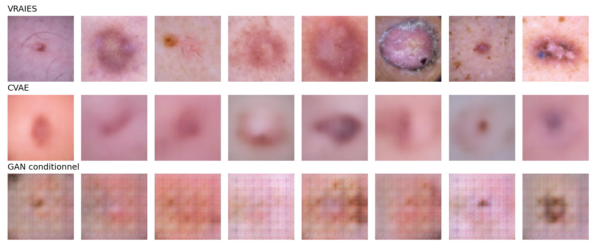
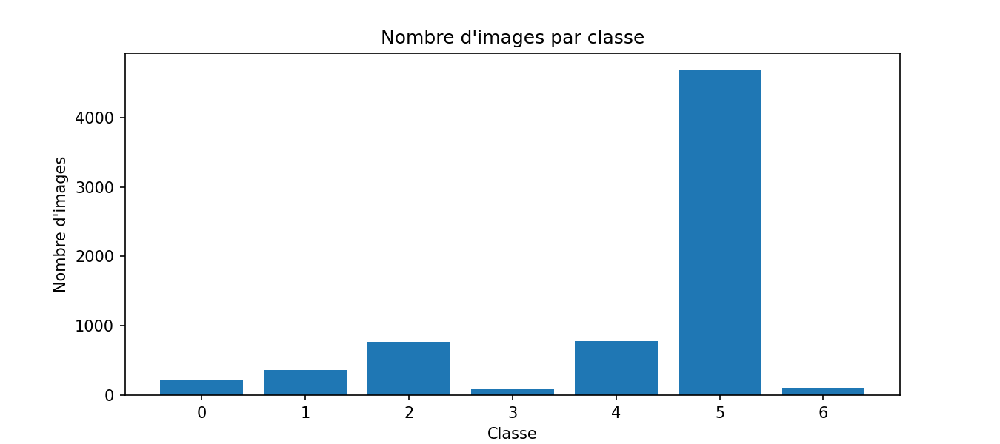
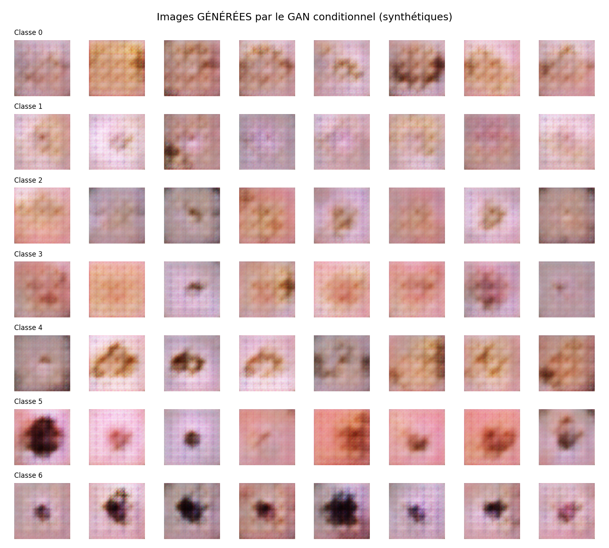
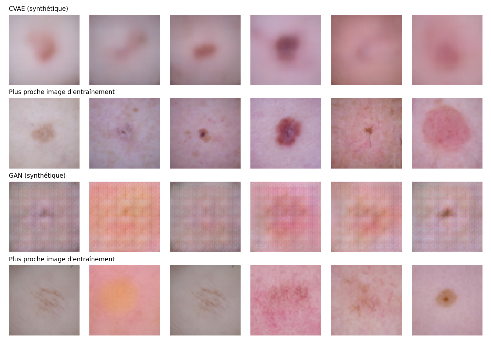
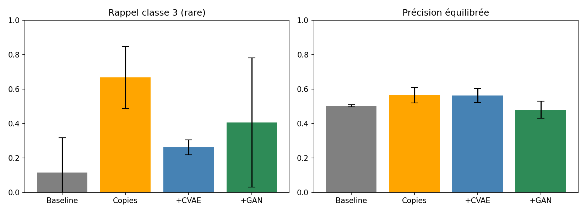

# Projet 2 – Génération d'images médicales contrôlées

Ce projet génère des images de dermoscopie **synthétiques** à partir de DermaMNIST en 64×64, avec deux modèles : un **CVAE** et un **GAN conditionnel**. On choisit la maladie (la classe) à générer. On vérifie ensuite si ces images aident un classifieur à mieux reconnaître la **classe rare**, la classe 3 (*dermatofibroma*), qui n'a que **80 images d'entraînement sur 7 007**.

> ⚠️ Les images générées servent uniquement à la recherche et à l'enseignement. **Ne jamais les utiliser pour un diagnostic.**

---

## Contenu du dépôt

| Dossier | Contenu |
|---|---|
| `notebooks/` | `projet2_images_medicales.ipynb` : notebook complet (étapes 1 à 7), avec toutes les sorties |
| `results/` | Figures (`.png`) et tableaux de résultats (`.csv`) |
| `demo/` | Démo Gradio (dans le notebook) et vidéo de démonstration |
| `data/` | Fiche des données (les images ne sont pas stockées dans le dépôt) |
| `docs/` | Licences et réflexion éthique |

## Lancer le projet

1. Ouvrir `notebooks/projet2_images_medicales.ipynb` dans **Google Colab**.
2. Cliquer sur **Runtime → Change runtime type → T4 GPU**.
3. Cliquer sur **Runtime → Run all**. Les données se téléchargent automatiquement, environ 100 Mo.

Durée totale : environ 1 h 30 sur un GPU T4. La mémoire GPU utilisée reste bien en dessous de 12 Go.

- Modèles entraînés (`cvae.pt`, `gan_generateur.pt`) : [Google Drive](https://drive.google.com/drive/folders/1gz97YYJ7Y5y9a7PLCqnztfvYarlK-as3)
- Vidéo de la démo : [Google Drive](https://drive.google.com/drive/folders/1gz97YYJ7Y5y9a7PLCqnztfvYarlK-as3) (la vidéo fait 37 Mo, trop pour l'envoi web sur GitHub)

---

## Données

DermaMNIST (MedMNIST v3) en 64×64, avec le découpage officiel : **7 007** images d'entraînement, **1 003** de validation et **2 005** de test, réparties en 7 classes.

| Classe | Nom | Images d'entraînement | Part |
|---|---|---|---|
| 0 | Kératose actinique / carcinome intra-épithélial | 228 | 3,3 % |
| 1 | Carcinome basocellulaire | 359 | 5,1 % |
| 2 | Lésion bénigne de type kératose | 769 | 11,0 % |
| **3** | **Dermatofibrome (classe rare)** | **80** | **1,1 %** |
| 4 | Mélanome | 779 | 11,1 % |
| 5 | Naevus mélanocytaire | 4 693 | 67,0 % |
| 6 | Lésion vasculaire | 99 | 1,4 % |

## Méthode

1. **Baseline** : un petit CNN de 4 blocs convolutifs, entraîné 20 époques. On garde l'époque qui a la meilleure précision équilibrée en validation.
2. **CVAE** : l'encodeur et le décodeur sont conditionnés par la classe (one-hot), avec un espace latent de 64 dimensions. Entraînement : 60 époques, perte = BCE + KL. Les classes rares sont tirées plus souvent pendant l'entraînement (poids 1/√effectif).
3. **GAN conditionnel** : le générateur reçoit le bruit et l'embedding de la classe. Le discriminateur reçoit l'image et la classe, avec *spectral normalization*. Entraînement : 100 époques, hinge loss, même tirage pondéré que le CVAE.
4. **Évaluation des images** :
   - FID global ;
   - pourcentage d'images reconnues dans la bonne classe par la baseline ;
   - test anti-mémorisation : distance au plus proche voisin dans le jeu d'entraînement.
5. **Utilité des images** :
   - on ajoute 500 images de classe 3 à l'entraînement **uniquement**, avec 3 essais par configuration ;
   - on fait aussi un **TSTR** : entraîner sur des images 100 % synthétiques, tester sur les vraies.
6. **Démo** Gradio : on choisit une classe et un modèle, et l'image générée porte le bandeau **« SYNTHÉTIQUE - IA »**.

---

## Résultats principaux

### 1. Qualité des images (FID, plus bas = meilleur)

| Comparaison | FID |
|---|---|
| Vraies vs vraies (référence) | 13,5 |
| **CVAE** | **212,5** |
| GAN conditionnel | 336,2 |

Les images du CVAE sont **floues** mais elles ont des couleurs et des formes plausibles. Les images du GAN sont plus contrastées, mais elles ont des **artefacts en damier** (motif de grille) dus aux convolutions transposées, ce qui explique leur FID plus élevé.

### 2. Le classifieur reconnaît-il la classe demandée ?

Pourcentage d'images générées classées dans la classe demandée par la baseline (200 images par classe) :

| Classe | 0 | 1 | 2 | **3** | 4 | 5 | 6 |
|---|---|---|---|---|---|---|---|
| CVAE | 0 % | 37,5 % | 9 % | **2 %** | 0 % | 96,5 % | 11 % |
| GAN | 19 % | 81,5 % | 23 % | **0 %** | 0,5 % | 89 % | 6 % |

Le conditionnement fonctionne bien pour la classe majoritaire (5), mais mal pour la classe rare. Ce test est toutefois limité, car la baseline reconnaît elle-même mal la classe 3, même sur de vraies images.

### 3. Les modèles recopient-ils les images d'entraînement ?

| Classe 3 | Distance médiane au plus proche voisin | Images suspectes de copie |
|---|---|---|
| Vraies images de test (référence) | 7,60 | – |
| CVAE | 6,54 | 4,3 % |
| GAN | 7,46 | 0,0 % |

**Pas de copie constatée.** Les 4,3 % « suspects » du CVAE viennent de son flou : une image floue est naturellement proche, au sens de la distance pixel, d'une image lisse. L'inspection visuelle montre que ces images sont **différentes** de leur plus proche voisin.

### 4. Les images synthétiques aident-elles la classe rare ?

Test réel, moyenne ± écart-type sur 3 essais :

| Expérience | Précision globale | Précision équilibrée | Rappel classe 3 | F1 classe 3 |
|---|---|---|---|---|
| 1. Vraies seulement (baseline) | 0,717 ± 0,045 | 0,503 ± 0,006 | 0,116 ± 0,201 | 0,119 ± 0,205 |
| 2. + 500 copies des vraies classe 3 | 0,712 ± 0,018 | **0,565 ± 0,046** | **0,667 ± 0,181** | **0,235 ± 0,073** |
| 3. + 500 synthétiques CVAE | **0,738 ± 0,012** | 0,563 ± 0,041 | 0,261 ± 0,043 | 0,174 ± 0,072 |
| 4. + 500 synthétiques GAN | 0,719 ± 0,040 | 0,480 ± 0,050 | 0,406 ± 0,375 | 0,109 ± 0,108 |

### 5. TSTR (entraînement 100 % synthétique, test sur les vraies images)

| Expérience | Précision globale | Précision équilibrée | Rappel classe 3 |
|---|---|---|---|
| TRTR : vraies → vraies (référence) | 0,745 | 0,514 | 0,087 |
| TSTR : CVAE → vraies | 0,531 | 0,394 | 0,000 |
| TSTR : GAN → vraies | 0,617 | 0,234 | 0,000 |

---

## Conclusions

- **Le CVAE est le meilleur générateur** dans ce projet : il a le FID le plus bas, il donne le meilleur TSTR en précision équilibrée (0,394 contre 0,234 pour le GAN), et il est le seul à améliorer la baseline de façon **stable**. Avec lui, le rappel de la classe 3 passe de 0,116 à 0,261 et l'écart-type passe de ± 0,20 à ± 0,04. La précision globale est aussi la meilleure (0,738).
- **Le GAN conditionnel n'apporte pas de gain fiable** : ses résultats sont très variables (rappel de 0,000 à 0,739 selon l'essai) et sa précision équilibrée baisse.
- **Le simple sur-échantillonnage (copies) reste la meilleure méthode pour le rappel de la classe 3.** Avec seulement 80 images réelles, les générateurs n'ont pas assez d'exemples pour apprendre les détails de cette classe.
- Le TSTR montre que les images synthétiques **ne remplacent pas** les vraies : aucune image de classe 3 n'est retrouvée.
- Aucune mémorisation n'a été détectée.

## Limites

- Le test ne contient que **23 images de classe 3** : une seule image bien ou mal classée change le rappel de 4,3 points. Les écarts-types sont donc grands.
- Il n'y a que 3 essais par configuration. Une baseline plus forte (ResNet pré-entraîné) donnerait des chiffres plus solides.
- Résolution de 64×64 uniquement.
- Les artefacts en damier du GAN pourraient être réduits avec un sur-échantillonnage `Upsample` + `Conv2d`, une augmentation différentiable (DiffAugment) et un entraînement plus long.

## Pistes d'amélioration

- GAN : `Upsample` + `Conv` à la place de `ConvTranspose2d`, DiffAugment, discriminateur à projection.
- Filtrer les images synthétiques avec un classifieur avant de les ajouter à l'entraînement.
- Combiner copies et images synthétiques.
- Tester un petit modèle de diffusion conditionnel.

---

## Références

- Yang, J. *et al.* « MedMNIST v2 – A large-scale lightweight benchmark for 2D and 3D biomedical image classification. » *Scientific Data*, 2023.
- Tschandl, P. *et al.* « The HAM10000 dataset. » *Scientific Data*, 2018.
- Sohn, K. *et al.* « Learning Structured Output Representation using Deep Conditional Generative Models » (CVAE), NeurIPS 2015.
- Mirza, M. & Osindero, S. « Conditional Generative Adversarial Nets », 2014.
- Miyato, T. *et al.* « Spectral Normalization for GANs », ICLR 2018.
